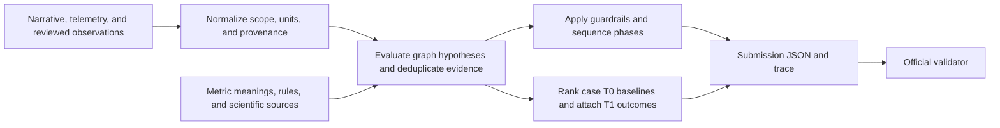

# Team 11 Ingaze Recommendation Engine

- **Team number and name** — Team 11
- **Team members** — To be supplied by the team
- **Chosen paradigm and stack** — Deterministic HR policy engine with weighted case-based retrieval, using standard-library Python and local JSON.

The prototype turns narratives, optional quantitative telemetry and reviewed observations into a three-phase action plan. The same knowledge graph drives recommendations for all three official scenarios. It runs offline with the synced 21-case dataset and the official validator. The [evidence-based design plan](docs/ARCHITECTURE_PLAN.md) records the research and claim review.

### Gap analysis

| Area | Starting point | Integration |
| --- | --- | --- |
| Intake | Phrase matches with unresolved scope. No companion telemetry join. | Normalized observations and measurements, exact telemetry joins, explicit units and source paths, and reviewed scope and period overrides. |
| Hypotheses | Graph drove plans only for supplied structured observations. | Every plan uses graph findings, same-scope alternatives, supporting and contradictory evidence, and missing evidence. |
| Independence | One slot per family, with source origins supplied by the caller. | Extend lineage to source references, known population overlap and declared construct dependencies. |
| Actions | Legacy and graph planners produced separate outputs. | One graph-driven planner with audited phase prerequisites, workforce fit, readiness and protected scopes. |
| Case matching | Qualitative tags over the original library. | Rank 21 cases with mechanism and workforce fit, compatible T0 peer gaps and scale. Attach T1 after ranking. |
| Verification | Unit tests and narrative demo. | Add integrated tests for official inputs, unseen companies, overlapping samples, contradictory evidence, prohibited actions and T1 leakage. |

## 1. Domain Representation & State Design

### 1.1 Core Data Models, Tables, Rules, or State Objects

| State | Current representation |
| --- | --- |
| Client intake | Scenario JSON with `scenario_code`, profile fields, `ingaze_platform_signals`, and `client_internal_context`. The code identifies the output record. |
| Evidence | Observation records identify a signal, polarity, quality, evidence type, source reference, origin IDs and scope. Measurements also carry units, denominator, horizon and comparable peer value when known. Excluded clauses or values appear in the trace. |
| Context and readiness | Set of profile tags derived from industry, workforce, footprint and organizational context. The planner also reads leadership requests, documented strengths, and cohort observations. Advocacy readiness requires an explicit culture-ready signal and no detected blocker. |
| Knowledge graph | Versioned JSON packs link metric paths to signals and required evidence families to diagnosis rules. Rules link to competing explanations, sources and phase gates. Structured observations resolve evidence with exact scope, source quality and lineage. |
| Planning rule | Graph rules specify required evidence slots, direct signals, alternatives, counterevidence, pilot and scale criteria. `hr_policy.TRACKS` supplies sandbox snippet references. |
| Case and research index | Baselines and narratives join by case name. Existing case tags are reused, and novel cases can supply tags or derive them from their starting narrative and telemetry. Research, context-specific empirical findings, operational guidance and challenge policy have distinct labels. |
| Output | Each scenario emits hypotheses, blocked requests, action lists for three phases, three case matches, relevant research, and optional strengths, cohort notes, and discovery questions. A trace exposes evidence paths, exclusions, blockers and retrieval scores. |



### 1.2 Representing Cross-Pillar Dynamics, Prerequisites & Sector Guardrails

- **Cross-pillar links.** A gap between recruiting promises and employee experience is associated with early exits and negative reviews. The same finding also blocks external advocacy. Mobile application friction points to a recruiting process problem. Local reputation and handoff evidence can narrow the affected cohort before any company-wide action.
- **Prerequisites.** Phase 1 collects evidence, Phase 2 proposes a structural pilot, and Phase 3 specifies when to scale. If expectation drift, management friction or burnout is detected, the planner defers immediate advocacy and emits a conditional reassessment. The prototype expresses most pilot and scale gates in action text. It does not monitor whether the prerequisites have been completed.
- **Workforce fit.** The planner excludes imported retail scheduling advice from a non-retail plan and blocks technical LinkedIn storytelling as the primary driver channel. It preserves an effective HQ channel. A retail precedent can still inform a freight mobile funnel where the intake shares that mechanism.
- **Evidence links.** Planning tracks and contextual actions select sandbox research by snippet ID. Case matches attach their historical outcomes and transfer scope. External topic matches supplement the research and carry applicability limits.

## 2. Client Intake Parsing, Normalization & Noise Filtering

1. Read the two intake objects. Keep executive requests separate from diagnosis. Use the healthy-baseline field as readiness evidence where applicable and carry the original strengths into the plan. Skip the summary and guiding questions to avoid counting restatements as new evidence.
2. Split text into clauses and use case-insensitive patterns for observations such as `early_attrition` or `mobile_friction`. Preserve the quote, polarity, numerical expressions and source. Infer conservative scope hints, with unresolved fields left null. Keep repeated reports in trace and conservatively group their evidence lineage.
3. Check local negation and quarantine clauses explicitly marked as unverified or linked to an external merchant pilot. Preserve excluded text in the trace. The engine does not use an LLM to infer facts. Phrase matching can miss unfamiliar wording and complex contradictions.
4. Join active telemetry by `scenario_code` and case telemetry by `case_name`. Preserve form abandonment per application start, conversion per portal visit, and distinct attrition horizons. Validate source ranges and put invalid observations in the trace. A peer gap can activate a proxy lead under a documented prioritization heuristic. A numerical proxy cannot fill a verified direct-evidence slot.
5. Read optional user-supplied observations and load the local research catalog. Additional JSON packs retain source links and applicability. Reviewed observations can declare verified evidence when the source actually supports it.

**Normalization boundary.** An `intake` marker identifies a snapshot assessment. It does not stand for known collection dates, and narrative volume does not establish source independence. The graph distinguishes explicit compatible scopes, unknown scope, and recognized aggregates. [Upstream telemetry dictionary](https://github.com/guglielmo-Ingaze/Ingaze-CF-Hackathon-2026/blob/main/docs/ANALYTICS_TELEMETRY_DICTIONARY.md)

## 3. Diagnostic, Prioritization & Action-Planning Mechanism

1. **Diagnose and preserve.** Index rules by their required signals and evaluate only the candidates reached by present, trustworthy observations in each cohort, site, tenure and assessment window. Match distinct evidence slots to independent lineage components. Mark unsupported parts as missing or dependent and attach contradicting observations and competing hypotheses. Carry documented baselines into the proposed pilot and defer pilots that overlap explicitly protected scopes.
2. **Evaluate requests and sequence work.** Route each track through diagnostics, a structural pilot, and conditional scale-up where applicable. A blocker defers advocacy. Positive culture evidence can permit a scoped opt-in pilot, subject to recruitment and reporting checks. Missing readiness prompts verification. Apply workforce fit to the requested intervention.
3. **Adapt actions.** For freight roles, test ads with verified route allowances, home-time and fleet details, and preserve essential eligibility checks in the mobile pilot. For clinical handoffs, consider a named local owner and measure callback times. Ask the client which mobile step loses eligible applicants or which site handoff explains delays.
4. **Rank precedents.** Score shared mechanisms and workforce attributes first. Add bounded adjustments for scale and for T0 peer-gap agreement on metrics with matching definitions, scope and horizon. Use at most one peer-gap comparison per evidence family. Penalize cases without relevant mechanisms and cross-sector retail cases without a transferable funnel mechanism. Break ties by case name, keep three, and show the rationale. Rankings are heuristic.
5. **Explain historical outcomes.** Attach the case narrative’s measured outcome and available T0/T1 pairs after selection. The telemetry is synthetic. An outcome supports discussion of a precedent, with transfer limits stated beside the match.

The organizer’s phase structure, workforce fit and readiness gates are challenge policies. Exact sandbox effect sizes are supplied references and are not used as scoring thresholds or forecasts by the current engine. The research plan flags claims requiring review and records external evidence for realistic job previews, survey design and other pilot choices. [Research and claim review](docs/ARCHITECTURE_PLAN.md)

## 4. Tech Stack & Production Trade-Offs

| Layer | Chosen tool / library | Why it fits |
| --- | --- | --- |
| Data / State | Local JSON, Python dictionaries and sets | Small inputs stay portable and field paths can be traced directly. |
| Reasoning / Planning | Python policy tables, explicit request checks and a weighted case ranker | Each recommendation or blocked request can be explained from the rules and intake. |
| LLM / Parsing | Python `re` and curated vocabularies | Reproducible offline parsing with no model calls or LLM token cost. Broader language coverage would require stronger extraction and validation. |
| Validation / Testing | Official validator, offline baseline and CLI mutation demo | Checks output format and demonstrates how a new input changes a recommendation. |

### Comparison with the offline baseline

| Scenario | What the baseline did | What the prototype did in the demo |
| --- | --- | --- |
| CloudNova | Proposed immediate external advocacy and retail shift rotation | Deferred advocacy, excluded the retail schedule and preserved documented pay and healthy baselines. KronoCart Tech and Alfa Group ranked as precedents for expectation and retention problems. |
| EuroFreight | Proposed technical LinkedIn content for drivers and immediate fast-apply | Kept LinkedIn for HQ, blocked the driver channel mismatch and put a funnel audit ahead of rollout. Beta Logistica ranked first. |
| VerdeCare | Proposed immediately automating ambassador tracking everywhere | Kept an opt-in pilot, held broader automation pending checks, and deferred advocacy when the demo added credible workload burnout. |

A flat prompt or unfiltered similarity search would still need explicit checks for eligibility, phase readiness and outcome comparability. A graph database could help with larger corpora. Local JSON keeps this run reproducible and easy to inspect. Comparison results above come from the supplied offline simulator.

**Open scientific and implementation questions.** Peer populations and sample selection can differ. The matching margins are prioritization heuristics, and published mechanism evidence does not establish the efficacy of the recommended intervention for a client. Undeclared source dependence and unobserved population overlap require analyst review. Free-text extraction can miss unfamiliar phrasing, complex negation and cross-reference scope. The engine proposes verification and evaluation gates but has no live company data feeds, longitudinal validation or automatic rollout. The source library needs further review before application to real companies.

```bash
python3 recommendation_engine.py --trace
python3 starter_baseline_and_validator.py --validate submission.json
python3 -m scripts.demo_recommendations
```

The current submission passes the validator for all three scenarios with zero structural warnings. The validator checks the format. The demo checks selected behaviors and prints the matched precedents.

Use `--dataset path/to/intake.json` to replay a modified intake, `--evidence-pack path/to/evidence.json` to add sources, or `--search-evidence "hybrid work"` to query the evidence catalog independently.

### Knowledge graph workflow

The built-in [graph pack](database/knowledge/hr_knowledge_graph.json) is the persistent knowledge catalog. `--graph-pack` adds signals, sources and rules by ID. New patterns can be authored without changing the Python evaluator. A graph export is available for visualization or database import.

The current catalog contains 26 diagnostic patterns. The additional alternatives cover candidate supply and channel reach, requisition approval, screening, interview capacity, offer acceptance, pre-start withdrawal, internal mobility, work-location feasibility, speaking up, review sample changes, and campaign attribution. Each added pattern asks for independent scoped evidence before proposing a pilot. The stage-specific inputs are optional extensions to the official schema. Where the client supplies only an overall delay or a headline metric, the planner asks for stage data. [Graph catalog with sources and limitations](database/knowledge/hr_knowledge_graph.json)

```bash
python3 recommendation_engine.py --out submission.json --trace-out outputs/ingaze-knowledge-graph/diagnostic_report.json --graph-out outputs/ingaze-knowledge-graph/graph.json
python3 -m unittest discover -s tests
python3 -m scripts.evaluate_historical_replay --out outputs/ingaze-knowledge-graph/historical_replay.json
```

The default sandbox run uses both official JSON datasets. Pass `--observations observations.json` with arrays keyed by scenario code, or add `diagnostic_observations` to each scenario in an alternate dataset. `--analytics` attaches a companion file to a custom intake. With `--no-analytics` the CLI skips the companion file. All these paths use the same graph.

```json
{
  "id": "audit-forms-01",
  "signal": "form_obstacle_verified",
  "state": "present",
  "quality": "verified",
  "source_ref": "ux-audit:device-walkthrough-01",
  "origins": ["device-walkthrough-01"],
  "scope": {
    "cohort": "frontline_driver_applicants",
    "site": "north_hub",
    "tenure": "applicant",
    "window": "2026-Q3"
  }
}
```

- Use matching scope IDs only for comparable observations. Use `null` for unknown scope and `all` for a known aggregate. A metric-based observation can include `metric_path`. Keep rate definitions, denominators and measurement horizons in the source record. `window` identifies the shared assessment period.
- Give every derived observation the IDs of all its underlying sources in `origins`. A cited document or data pointer in `source_ref` helps an analyst audit the claim. Populate `population_ids` with shared de-identified sample IDs and `dependency_ids` with known derived-construct links.
- Each rule needs distinct evidence families. Alternate signals in a family can fill one slot. The evaluator chooses a maximum matching between slots and independent origin groups, with a verified direct observation required for support. The trace records selected observations, related observations that did not count again, and counterevidence. Support justifies a scoped pilot proposal, with diagnostics still required.
- Evidence records identify their source type and limits. A company can introduce a new case in an alternate dataset by supplying its case narrative and optional `mechanism_tags`. Use reviewed evidence for causal interpretation and pilot design.

The historical replay uses the fixed graph and one company's narrative and T0 as input. It excludes that company and its outcomes from that run's precedent library. This checks for self-matching and outcome leakage. The historical data supply no independent diagnostic labels, so the replay cannot estimate root-cause accuracy. Test fixtures exercise competing explanations on unseen profiles, alongside the three official acceptance cases.
