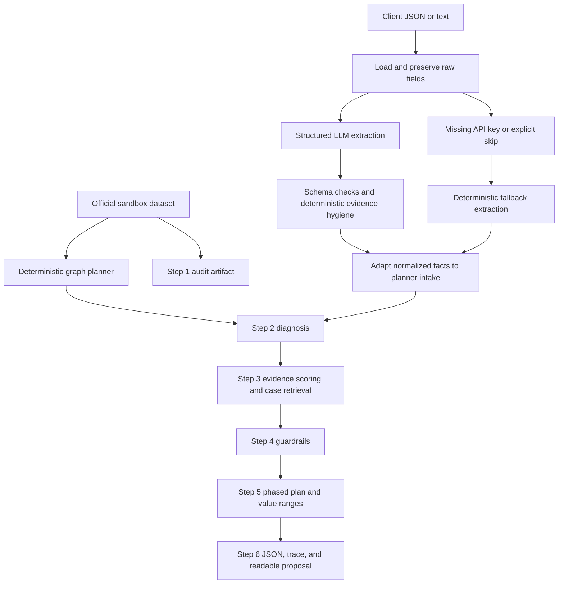

# Architecture & Reasoning Blueprint — Team 11

**Status:** Describes the current repository implementation.

- **Team number:** 11
- **Team members:** Not listed in the repository.
- **Chosen paradigm:** Structured LLM intake extraction followed by a deterministic, evidence-linked graph planner, policy gates, and case-based ranking.

The system separates what a client reports from what the planner concludes. The LLM can normalize a client brief into typed facts and signals; it does not choose interventions or write the JSON plan. The downstream Python stages diagnose, score, apply guardrails, sequence actions, estimate precedent-based value, and assemble the submission.

## 1. Domain Representation and State Design

### 1.1 Data models and reference data

The repository stores domain and client data as JSON. `database/ingaze_sandbox_dataset.json` contains the four HR pillars, field notes, research snippets, 21 historical case narratives, and the three official scenarios. `database/knowledge/hr_knowledge_graph.json` is the active diagnostic graph; it currently defines 92 signals and 26 rules. Optional client and case telemetry lives in `database/ingaze_synthetic_analytics_snapshots.json`. Reviewed case records and scoring rules are available under `database/normalized/`.

Pydantic models in `src/schemas/` define the main interfaces:

| State | Contents |
| --- | --- |
| `RawScenarioBundle` | Raw scenario JSON plus optional typed T0 telemetry and peer benchmarks. |
| `NormalizedClientInput` | Company profile, sector and workforce tags, canonical signals with evidence quotes, healthy baselines, cohort/site asymmetries, leadership requests, budget constraints, and filtered noise. |
| Intake observation | A scoped graph signal with an ID, state, quality, source reference, origin, evidence type, and source text. The scope can include cohort, site, tenure, and window; unknown fields remain unknown. |
| Diagnosis state | Profile tags, observations, graph hypotheses, evidence slots, counterevidence, and prioritization order. |
| Scored candidate state | Evidence scores, ranked reviewed case matches, candidate actions, and research references. |
| Guardrail and phase state | Protected scopes, blockers, action decisions, Phase 1 audits, conditional Phase 2 pilots, Phase 3 scale gates, and client questions. |

Graph rules carry their requirements, direct evidence slot, source references, diagnostic check, pilot, scale gate, counters, alternatives, and track tags. The rule set represents relationships across employer reputation, recruiting, advocacy, and retention without matching on company names.



The official `--sandbox` route intentionally keeps the established planner input unchanged for reproducibility. It writes a deterministic Step 1 audit record, then plans from each official scenario directly. Custom `--client-input` records and `--sandbox --extra-scenario` records go through the Step 1 normalization and adaptation path before planning.

### 1.2 Cross-pillar links, prerequisites, and evidence

The graph treats a reported problem as a lead, not automatically as a root cause. A rule can require evidence from multiple slots and can list counter-signals and alternative explanations. For example, the expectation-drift rule connects a documented recruiting promise or expectation gap with early attrition, then asks the operator to compare dated promises, actual work practices, and exit reasons over the same hire window.

The planner preserves the status and scope of each hypothesis. Supported, plausible, and conflicted hypotheses remain distinguishable in the trace. `prioritized()` favors supported evidence, direct signals, reported evidence, coverage of required slots, and specific scopes. Symptom-only alternatives are not all promoted into the recommended root-cause list.

Guardrails run after candidate scoring and before action sequencing. They check active blockers such as expectation gaps, management problems, or burnout; protected healthy scopes; workforce and sector fit; direct evidence; and a minimum evidence score. A request can trigger evaluation or fast-track a scoped pilot only when its evidence/readiness conditions are met. A request by itself cannot satisfy a prerequisite. Phase 2 actions remain conditional, and Phase 3 actions state the conditions for scaling.

Step 3 uses reviewed normalized cases, weighted problem overlap, workforce and sector fit, ROI evidence, and CFO auditability to rank up to three precedents. T0 information informs matching; historical outcomes are displayed after selection. The ROI estimator applies measured before/after changes for the same metric to a client-stated or observed baseline. It labels ranges as reference estimates, not forecasts; overlapping levers are not additive, and hours are not converted to money without an hourly cost.

## 2. Client Intake Parsing, Normalization, and Noise Filtering

`src/pipeline/step1_normalize_input.py` accepts plain-text briefs and JSON objects or lists, including wrapped `client_intake_case` files. It preserves nested discovery notes, survey answers, telemetry, and other raw fields in the LLM prompt. The normalizer requests a Pydantic-validated extraction containing canonical signal codes, short evidence quotes, sector/workforce tags, healthy baselines, asymmetries, stakeholder requests, and budget constraints. Leadership proposals remain requests, not recommendations.

The structured client uses an OpenAI-compatible API, with OpenAI, OpenRouter, and Gemini configurations supported. It requests temperature-zero structured output, validates the response against the extraction model, and has a JSON-mode compatibility path. The LLM is followed by deterministic checks and deduplication:

- Signal codes, sector categories, workforce archetypes, and action categories must match the declared enums.
- Evidence quotes are compared with raw source text using normalized text, metric key/value matching, or token overlap. Weak overlap is logged for review; it is not silently treated as proof.
- Signals explicitly flagged as unverified/external or incompatible retail-shift evidence for a non-retail workforce are quarantined. Marked unverified excerpts are also searched in nested input fields.
- Unknown values remain unknown. Raw ranges, N/A answers, nulls, mixed windows, and confounded aggregate measures are not treated as precise measurements.

If no supported API key is configured, the custom path reports that it is using deterministic extraction. `--skip-llm-normalization` selects that fallback explicitly. `src/pipeline/messy_intake.py` provides additional pattern-based handling for the organizer's discovery-call/survey format in this fallback. Its coverage is narrower than the LLM path and can miss unfamiliar phrasing.

The client adapter in `src/main.py` converts normalized signals into graph observations and carries normalized healthy baselines, asymmetries, leadership requests, budget constraints, and quarantined excerpts into the planner. It retains source evidence in the reasoning trace. Step 2 also normalizes scenario narrative and analytics into the same scoped observation shape.

## 3. Diagnosis, Prioritization, and Action Planning

`src/main.py` orchestrates the following deterministic stages for each plan:

1. **Step 2 — Diagnosis:** `run_root_cause_analysis()` builds workforce profile tags, normalizes narrative and telemetry, evaluates graph rules, records evidence slots and counterevidence, and prioritizes hypotheses.
2. **Step 3 — Scoring and retrieval:** `score_diagnostic_candidates()` calculates an auditable evidence score from rule status, evidence-slot coverage, direct/reported evidence, and scope specificity. It retrieves reviewed historical cases and supporting research, then scores candidate actions. The case ranking is a heuristic for retrieval, not a causal effect estimate.
3. **Step 4 — Guardrails:** `evaluate_guardrails()` applies blockers, explicit protected scopes, sector/workforce fit, readiness, evidence sufficiency, and policy constraints. It records reasons for conditional, deferred, or excluded actions.
4. **Step 5 — Phasing and value:** `build_reasoning_phase_plan()` places diagnostics in Phase 1, eligible scoped pilots in Phase 2, and measured expansion gates in Phase 3. Open evidence questions stay with the relevant hypothesis. `estimate_roi()` adds comparable historical ranges and pilot targets when a usable baseline and precedent exist.
5. **Step 6 — Export:** `assemble_recommendation()` produces the eight required scenario fields and the three supported enrichment fields. It also assembles a trace with observations, hypothesis states, decisions, evidence lineage, case ranking, and guardrails. A readable Markdown proposal is rendered from those decisions. Optional LLM polishing can edit that Markdown draft; it does not decide or rewrite the submission JSON plan.

The root `submission.json` contains only the three official scenarios, A, B, and C. It is checked against `SubmissionPayload` and the organizer validator. A custom-client run validates against its input scenarios. A combined blind regression run uses a separate output file so it does not change the official submission:

```bash
# Three official scenarios
python recommendation_engine.py --sandbox --out submission.json
python starter_baseline_and_validator.py --validate submission.json

# Sunday Meridiana blind regression run (separate four-scenario artifact)
python recommendation_engine.py --sandbox --extra-scenario data/ingaze_sunday_blind_test_meridiana.json --out submissions/sunday_blind_submission.json --proposal-out submissions/sunday_blind_proposal.md
python starter_baseline_and_validator.py --validate submissions/sunday_blind_submission.json --extra-scenario data/ingaze_sunday_blind_test_meridiana.json
```

Use `--client-input PATH` for a standalone custom brief. Set `LLM_API_KEY`, `OPENAI_API_KEY`, `OPENROUTER_API_KEY`, or `GEMINI_API_KEY` in the environment or the ignored project `.env` file to enable structured LLM normalization. `--trace-out PATH` writes the per-scenario reasoning trace.

## 4. Stack and Production Trade-offs

| Layer | Implementation | Trade-off |
| --- | --- | --- |
| Data and state | JSON source files, Pydantic 2 models, normalized case/rule JSON, and per-stage JSON artifacts. | Easy to inspect and reproduce locally; no transactional database or live synchronization. |
| Intake | Structured LLM extraction through `openai` SDK-compatible endpoints, followed by deterministic validation and hygiene. | Handles varied language and nested intake while keeping decisions outside the LLM; requires credentials for live normalization and can still misclassify facts. |
| Reasoning and planning | Python graph rules, weighted scoring, explicit guardrails, and deterministic phase planning. | Inspectable and repeatable; rule coverage and phrase adapters require maintenance as new evidence patterns appear. |
| Cases and value | Reviewed case records, weighted case ranking, same-metric historical deltas, and traceable references. | Gives relevant precedents and bounded reference ranges; synthetic historical results do not establish causal effects for a new client. |
| Validation | Pydantic models, organizer validator, and regression tests. | Catches structural and selected policy regressions; schema validity does not prove diagnosis quality or business impact. |

Compared with the organizer's flat single-prompt baseline, this design exposes the evidence and policy decision behind each action and can block unsupported or out-of-scope plans before export. The documented baseline comparison reports three case matches per official scenario, healthy-baseline protections, and actions in all three phases. Those results are a prototype comparison, not proof of general accuracy. Live LLM quality and vector-RAG comparisons have not been established; rule-based extraction can miss novel language, and the graph can encode imperfect assumptions. The system should be judged by whether its evidence, scope, uncertainty, and next verification step are inspectable.
