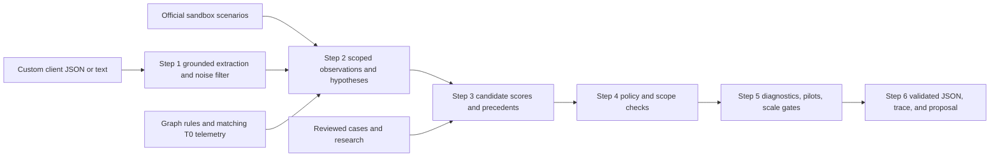

# Team 11 — Ingaze HR Recommendation Engine

- **Team number and name** — Team 11
- **Team members** — Roster pending confirmation
- **Paradigm and stack** — Python and Pydantic with a typed evidence graph, deterministic policy gates, and weighted case-based reasoning over local JSON.

## 1. Domain representation and state design



### 1.1 Core state

| State | Fields and keys used by the engine |
| --- | --- |
| Client bundle | `RawScenarioBundle` carries `scenario_code`, `raw_scenario`, optional `t0_telemetry` and `sector_benchmarks`. `NormalizedClientInput` adds canonical signals with evidence quotes, sector, workforce archetypes, healthy baselines, cohort asymmetries, leadership requests, and rejected excerpts. |
| Observation | `id`, `signal`, `state`, `quality`, `scope`, `source_ref`, `origins`, optional `population_ids`, `dependency_ids`, and `metric_path`. `scope` has `cohort`, `site`, `tenure`, `window`. Numeric measurements carry value, unit, denominator and measurement horizon when available. |
| Graph pack | Versioned dictionaries keyed by signal, rule and source IDs. A signal has a `family`, `role`, `meaning` and optional metric paths or narrative pattern. A rule has required evidence slots (`requires`), a distinguished `direct` slot, counter-signals, alternative rules, cited sources, and `diagnostic`, `pilot` and `scale_gate` actions. |
| Hypothesis and decision | Rule ID and scope, status, selected and contradictory evidence IDs, missing and dependent families, competing hypotheses, score breakdown, policy decision and prerequisite. Stage handoffs are saved under `data/intermediate_steps/<scenario_code>/`. |
| Historical case | `NormalizedCaseStudy` joins to the sandbox and telemetry via exact `case_name`. It carries a `case_id`, review status, sector, workforce, size, T0 problem tags and strengths, intervention steps, cited snippet numbers, T0/T1 snapshots and quantified outcomes. |

The graph has **92 signals, 26 rules and 26 sources**. The reference data includes **21 reviewed historical cases and 10 organizer research snippets**. Graph sources carry a URL, finding and limitation. Output distinguishes scientific findings, observational or context-specific findings, operational guidance, organizer references and mandatory constraints. Peer-gap margins and ranking weights are engineering heuristics. [Graph](database/knowledge/hr_knowledge_graph.json) · [Case schema](src/schemas/domain_models.py) · [Research classification](src/pipeline/step3_conditions_scoring.py)

### 1.2 Cross-pillar mechanisms, prerequisites and guardrails

- **Cross-pillar diagnosis.** `expectation_drift` requires evidence of a promise mismatch and early exits in a compatible scope. The graph models recruiting claims and employer reputation as possible contributors to retention problems. It checks alternatives such as management practice, onboarding and workload, and records evidence that expectations were met as a contradiction. An active trust or workload problem also constrains employee advocacy.
- **Evidence independence.** Each rule requires distinct evidence families, with alternatives within a slot sharing a family. Union-find groups observations transitively by source reference, origin, known population ID and declared dependency ID. Maximum matching assigns at most one independent component per required slot. Its trace identifies what was selected, duplicated or still missing.
- **Scope and readiness.** Step 4 can block a candidate for conflicting evidence, protected-scope overlap, incompatible workforce, missing readiness or a score below `0.35`. A non-retail profile blocks store shift rotation. A freight profile restricts technical LinkedIn content for driver hiring. External advocacy goes through its own readiness rule. Phase 2 is conditional on diagnostic verification, and Phase 3 requires a successful scoped pilot and guard-metric review. [Diagnosis](src/pipeline/step2_root_cause_analysis.py) · [Guardrails](src/pipeline/step4_guardrail_check.py) · [Phase planner](src/pipeline/step5_phase_planner.py)

## 2. Client intake, normalization and noise filtering

1. **Choose the input route.** `--sandbox` loads the three official dual-intake scenarios and sends them directly to Step 2. `--client-input` runs Step 1 for custom files. The organizer's `client_intake_case` JSON uses a deterministic adapter for reported evidence, missing values, quarantined telemetry and explicit restrictions. Other client JSON or text briefs can use structured LLM extraction or the existing deterministic fallback.
2. **Ground and normalize.** Step 1 checks signal quotes or metric pairs against the source text and telemetry, merges duplicate canonical signal codes and retains affected-cohort labels. Step 2 records narrative clauses as reported observations, preserves polarity and source paths, and validates reviewed records and numeric telemetry. Early exits expressed as “six-month churn” or “first-year attrition” can support the same concept while measured rates retain the 6- or 12-month horizon and new-hire denominator when known.
3. **Join and filter.** The companion snapshot joins on exact `scenario_code`. Inline telemetry takes precedence where supplied. Unit and range checks reject invalid values, and scope can retain an intake window or reviewed ISO date interval. Step 1 records ungrounded or contaminated excerpts. Step 2 filters known noise and separates leadership requests and healthy baselines from evidence of a problem. Missing or unresolved fields remain visible in the trace. [Intake parser](src/pipeline/step1_normalize_input.py) · [Normalization](src/pipeline/step2_root_cause_analysis.py)

## 3. Diagnosis, prioritization and action planning

1. **Step 2 — Evaluate competing explanations.** Group observations by exact cohort, site, tenure and window. A hypothesis is `supported` when an explicit scope, independent coverage and verified direct evidence satisfy its rule. A provisional lead is `plausible`. Counterevidence yields `conflicted`. Unmet alternatives and unresolved scopes remain visible in the trace. These labels describe support for investigating a local mechanism.
2. **Step 3 — Score candidates and retrieve precedents.** The candidate score is `0.85 × local evidence score + 0.15 × precedent fit`. The local score combines status, slot coverage, direct and reported evidence, and scope specificity. The case matcher uses Step 1 canonical signals or translates Step 2 diagnosis tags and site asymmetry. It filters to reviewed cases available in the dataset, requires a shared problem tag, and excludes desk/frontline mismatches without a shared archetype. It ranks the survivors using Dice problem overlap (`0.35`), workforce (`0.25`), sector (`0.15`), quantified evidence coverage (`0.15`) and CFO auditability (`0.10`), with ties broken by case ID. If that path yields no matches, the narrative matcher provides a fallback and labels weak transfer as context-only. Historical outcomes and size ratios accompany the match. ROI evidence coverage rewards availability without using the magnitude of past improvement in similarity.
3. **Steps 4–5 — Route and sequence.** Preserve documented strengths and explicit protected scopes, run same-scope verification before a structural pilot, then require measured pilot outcomes before scale. Case-derived actions are traceable ideas for review. The executable plan comes from graph rules and scoped pilot designs, such as checking phone eligibility at one freight hub and giving qualified applicants a callback slot. Missing or contradictory evidence becomes an explicit client discovery question. **Fast track instead of blanket deferral:** a pilot that leadership explicitly requests may start in parallel with Phase 1, scoped to the affected sites and never network-wide, but only when the intake already contains direct evidence of the mechanism (e.g. a documented form obstacle) or, for advocacy, verified readiness (healthy culture, existing organic advocates, no Say-Do gap or burnout blocker). The same request is deferred when that evidence is missing; tests flip both cases by editing one scenario fact. [Guardrails](src/pipeline/step4_guardrail_check.py) · [Planner](src/pipeline/step5_phase_planner.py)
4. **Expected value and pilot targets.** Every Phase 2 pilot carries a measurable target: the client's current value moved by the median before/after change of the same metric in the matched precedents, shown next to the sector peer benchmark. Phase 3 scales only when that target is reached in the pilot scope. The CFO view multiplies the client's own baseline (current telemetry or an amount stated in the brief, annualized from its period) by the smallest and largest precedent improvement, giving a range rather than a forecast. Lines can overlap and are not summed. Without a precedent that measured the same metric there is no number, only a verification note, and staff hours are not converted to EUR because no hourly cost is supplied. [ROI estimator](src/offline/roi_estimator.py)
5. **Step 6 — Export.** Assemble diagnoses, guardrails, three phase arrays, case ROI, expected-value ranges, research, protected strengths and questions. Serialize through `SubmissionPayload` and run the organizer-format checks on sandbox output. `--trace-out` records observations, evidence lineage, candidate scores, case fit and routing decisions. A readable proposal is generated from the same state. [Matcher](src/offline/case_matching.py) · [Scoring](src/pipeline/step3_conditions_scoring.py) · [Export](src/pipeline/step6_hr_proposal.py)

## 4. Tech stack and production trade-offs

| Layer | Implementation | Trade-off |
| --- | --- | --- |
| Data and state | Local JSON, Pydantic 2 models and explicit IDs | Keeps the prototype portable and diffable. Larger case collections would benefit from indexed storage. |
| Reasoning and planning | Python graph evaluation, weighted retrieval and deterministic policy | Evidence slots and hard gates are easy to inspect and test. New mechanisms require rule and signal authoring. |
| Parsing | Rule-based extraction with optional structured LLM intake | The benchmark and offline path use zero LLM tokens. Custom extraction can add provider latency and requires grounding checks. |
| LLM (optional) | Any OpenAI-compatible endpoint via `LLM_BASE_URL` / `LLM_MODEL`; development default `gpt-4o-mini` | No LLM runs in the sandbox route, so the judged output depends on no proprietary model. For a fully open stack, point the client at an open-weight model served locally (e.g. Ollama or vLLM). Temperature 0, Pydantic-validated output and quote-grounding checks keep extraction auditable, and a deterministic fallback runs without any key. |
| Validation | Pydantic, `unittest`, stage traces and organizer validator | Distinguishes format checks from judgment about case transfer, data quality and causal claims. |

**Compared with the organizer’s naive flat-prompt baseline.** The baseline was run locally using the organizer’s mock mode. Both outputs passed validation with zero warnings. The detailed comparison includes per-scenario decisions, counts and reproduction commands. [Baseline comparison](docs/baseline_comparison.md)

| Scenario | Naive baseline | Team 11 run | Historical matches |
| --- | --- | --- | --- |
| A — CloudNova | Launches advocacy in Phase 1 and imports retail shift rotation. | Defers advocacy, excludes retail scheduling and preserves the healthy Amsterdam cohort. | Alfa Group, KronoCart Tech, QuantEx Markets |
| B — EuroFreight | Starts technical LinkedIn content and fast-apply before a portal audit. | Keeps HQ’s channel, fast-tracks a scoped fast-apply pilot at the affected hubs (the form obstacle is documented) instead of a network-wide rollout, and scopes the recruiter handoff to Bologna and Naples. | Beta Logistica, TransEuropa Supply Chain, Meridian Express Logistics |
| C — VerdeCare | Automates ambassador tracking across all locations immediately. | Preserves the healthy EVP, accelerates an opt-in cohort of the existing organic ambassadors, and defers only network-wide tracking automation until local profiles are audited. | VitaCare Network, VerdiCraft Botanicals, NaturaPure Group |

**Alternative designs.** Flat prompts and vector retrieval offer flexible text handling and fast initial retrieval. The graph and policy layer makes source independence and prerequisites explicit. A database-backed graph or rules service would improve indexing and multi-user management while adding infrastructure to the demo. Local files keep the deterministic route inexpensive to run. CFO review can inspect case fit and observed ROI separately from a proposed client outcome.

**Verification.** The sandbox run reproduces the committed submission, with three scenarios and zero organizer validation errors or warnings. All 110 tests pass, including protections, contradictions, duplication, ROI grounding and live-tweak mutations: removing the documented form obstacle defers fast-apply, and adding burnout to VerdeCare stops the advocacy fast track. [Tests](tests/) · [Proposal JSON](submissions/proposal.json) · [HR proposal](submissions/hr_proposal.md)

**Robustness to reworded briefs.** Cohorts are detected from generic role vocabulary per workforce (e.g. HGV or lorry drivers, logistics associates, developers, caregivers, care homes), with a fallback to the client's own `workforce_target`. “HQ” counts as a cohort only when HQ people are meant. Sites come from the client's footprint, so renamed hubs are scoped correctly. In “X (vs. Y)” comparisons the subject's sites are kept. Population-specific studies, such as retail-only experiments, are cited only for matching client profiles. Regression tests cover synonym swaps and renamed sites.

**Live intake limit.** The raw format adapter extracts recognized patterns and preserves source paths. It treats self-reports as provisional, flags untracked metrics, and withholds unfiltered aggregates from diagnosis. New survey fields and unrecognized wording may require additional mappings. [Adapter](src/pipeline/messy_intake.py) · [Organizer’s live intake format](https://github.com/guglielmo-Ingaze/Ingaze-CF-Hackathon-2026/blob/main/data/ingaze_real_world_messy_intake.json)

```bash
python3 recommendation_engine.py --sandbox --out submissions/proposal.json --proposal-out submissions/hr_proposal.md --trace-out trace.json
python3 starter_baseline_and_validator.py --validate submissions/proposal.json
python3 starter_baseline_and_validator.py --run-naive-baseline --out naive_baseline.json
python3 -m unittest discover -s tests
```

See the machine-readable [architecture](ARCHITECTURE.json).
