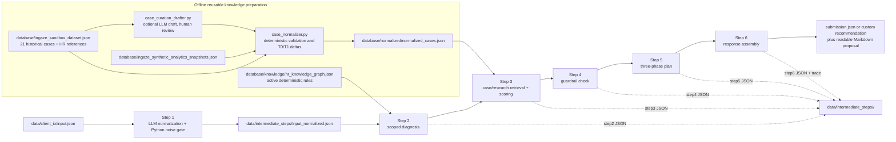

# Ingaze Recommendation Engine: Project Guide

This guide describes how the repository works **as the code is currently wired** and maps it to the intended flow in the team whiteboard: prepare reusable rules and historical cases offline, normalize an incoming client, diagnose and score deterministically, check guardrails, plan phases, and produce an auditable response.

## Overall flow



The whiteboard's central idea is right: historical cases provide precedents and possible ideas, while general rules decide what is justified and safe for this client. A case outcome is not a promise that the same result will happen again.

## Online pipeline: what each step does

| Stage | Main file | Role and rules |
|---|---|---|
| Step 1: normalize input | `src/pipeline/step1_normalize_input.py` | Reads a client JSON brief, optional T0 metrics, and profile/context fields. The LLM maps language to the exact enums in `src/schemas/`; Python then quarantines explicitly unverified/external-pilot data, rejects physically impossible retail-shift evidence, grounds evidence quotes, and deduplicates repeated signal codes. It extracts healthy baselines, cohort/site asymmetries, and leadership requests separately. It does not recommend actions. |
| LLM helper | `src/utils/llm_client.py` | Reads `LLM_API_KEY`, provider-specific key fallbacks, optional `LLM_BASE_URL` and `LLM_MODEL`; requests temperature `0.0`; validates Pydantic output and falls back to JSON mode for compatible APIs. `.env_template` shows the supported settings. |
| Step 2: root-cause analysis | `src/pipeline/step2_root_cause_analysis.py` | Builds scoped observations from narratives, reviewed inputs, and telemetry; evaluates the active knowledge graph's evidence slots, direct evidence, counterevidence, source lineage, and cohort/site/window scope. The output includes hypotheses and a ranked list. Multiple repeated statements from the same source do not automatically count as independent evidence. |
| Step 3: conditions and score system | `src/pipeline/step3_conditions_scoring.py` plus `src/offline/case_matching.py` | Scores diagnosis candidates, retrieves source-linked research, and (when Step 1 canonical signals are supplied) ranks reviewed normalized historical cases and extracts action ideas. Details are in [Case store and scoring](#case-store-and-scoring). |
| Step 4: guardrail check | `src/pipeline/step4_guardrail_check.py` | Checks evidence status, blockers, protected scopes and workforce/action fit. A diagnosis candidate needs a Step 3 score of at least `0.35` and must pass the deterministic checks to become a conditional pilot. It keeps historical case actions marked as ideas; they cannot override live evidence or guardrails. |
| Step 5: phase plan | `src/pipeline/step5_phase_planner.py` | Builds Phase 1 audits/listening, Phase 2 scoped structural pilots, and Phase 3 conditional scale actions from eligible graph hypotheses. It adds finance/EMV audit checks and stage-unknown hiring diagnostics. A pilot carries a prerequisite and a scale gate. Some adaptation is rule-based on broad workforce/profile traits. |
| Step 6: proposal and response | `src/pipeline/step6_hr_proposal.py` | `assemble_recommendation()` preserves the machine-readable JSON contract. `generate_hr_proposal()` renders approved Steps 2-5 into an executive diagnosis, guardrails, three-phase roadmap, precedents/research, and client questions. Optional structured LLM polish is limited to the summary and falls back to deterministic text. |

Each stage's result is handed to the next stage as a Python object/dictionary and persisted for inspection. The normal live orchestrator is `src/main.py`.

## Case store and scoring

The GitHub change was selectively brought over from [commit `91e2b3f`](https://github.com/SyAndrey006/Ingaze-CF-Hackathon-2026-Team-11/commit/91e2b3f), rather than merging the whole branch. It adds a curated case store and the offline tools around it. The current `database/normalized/normalized_cases.json` has **21 cases, all marked `reviewed`**.

On the custom-client path, Step 3 loads this case store when the normalized client has canonical signals. It excludes any case not marked `reviewed`, then ranks at most three using the weights read from `database/normalized/normalized_rules.json`:

| Case match component | Weight |
|---|---:|
| Canonical problem-signal overlap (Dice score) | 0.35 |
| Workforce fit | 0.25 |
| Sector fit | 0.15 |
| Historical ROI evidence | 0.15 |
| CFO auditability | 0.10 |

Desk-based and frontline cases with no shared workforce archetype are hard-excluded. Candidate intervention categories are collected only from cases with both a shared problem signal and a shared workforce archetype. Step 3 records those as `precedent_idea_for_review`; Steps 4–5 do not automatically turn a case's old intervention into a new client's action. Current graph diagnosis and guardrails control the live plan.

The candidate diagnosis score is separately calculated in Step 3 from support status (40%), evidence-slot coverage (25%), direct evidence (15%), reported direct evidence (15%), and scope specificity (5%). The final candidate score combines 85% of that evidence score and 15% historical mechanism fit. Step 4 applies the `0.35` minimum, then checks blockers and protected scopes.

### Current use by run mode

- **Custom-client mode** (`recommendation_engine.py --client-input ...`): runs Step 1, then Step 2–6. When Step 1 extracted canonical signals, Step 3 uses the normalized 21-case store and emits `normalized_case_matches` and `case_informed_action_candidates` in the stage output and trace.
- **Official sandbox mode** (`recommendation_engine.py` with no client flag): preserves the existing three-scenario behavior. It bypasses Step 1 and uses Step 3's existing raw historical-narrative matcher. This avoids changing the official output path; it means the new normalized case matcher is not currently used by this mode.
- **No-key custom mode** (`--skip-llm-normalization`): sends the raw brief through deterministic intake. Because this minimal Step 1-shaped record has no canonical extracted signals, it uses the existing raw-narrative case matcher rather than the normalized matcher.

So the normalized cases are connected at their intended Step 3 precedent/scoring stage for LLM-normalized custom clients, but they are not yet the matcher for every run mode.

## Active rules: what the engine actually uses

The main deterministic knowledge source is [`database/knowledge/hr_knowledge_graph.json`](database/knowledge/hr_knowledge_graph.json), not the normalized-rules template. The graph contains signal definitions, evidence families, source lineage, diagnostic rules, competing explanations, pilot/scale text, and research/source references. The evaluator checks whether separate evidence slots can be supported by sufficiently independent origins within compatible scopes; it records missing evidence and counterevidence rather than treating every phrase as proof.

Other active deterministic checks live in Python:

- Step 1's contamination markers and quote grounding.
- Step 3's case score formulas, top-three limit, and historical retrieval rules.
- Step 4's blockers, protected-scope overlap, action-fit checks, and minimum evidence score.
- Step 5's prerequisite/phase logic and a few broad profile-based pilot adaptations.

`database/normalized/normalized_rules.json` currently contains the five scoring weights, but its root-cause, threshold, action-condition, guardrail, phase-sequencing and research arrays are empty. It is not the source of active universal rules. The unused normalized-rule/raw-scenario loader stubs and alternate typed Step 2-5 entrypoints have been removed; the live stages use graph-driven production entrypoints.

## Repository map

```text
recommendation_engine.py              Public compatibility CLI/facade into src.main
starter_baseline_and_validator.py     Challenge-provided baseline, inspector, and validator
submission.json                       Root-level official three-scenario submission artifact

src/
  main.py                             CLI, custom-client bridge, pipeline orchestration, JSON persistence
  schemas/
    domain_models.py                  Canonical HR enums and database/domain Pydantic models
    pipeline_models.py                Typed input/output contracts between stages
    submission_models.py              Submission output schema
  pipeline/
    step1_normalize_input.py          Client brief extraction, hygiene, and standalone CLI
    step2_root_cause_analysis.py      Deterministic graph/intake diagnosis
    step3_conditions_scoring.py       Candidate scoring, case/research retrieval
    step4_guardrail_check.py          Blocker, scope, and action-fit decisions
    step5_phase_planner.py            Phase 1–3 assembly and sequencing
    step6_hr_proposal.py              JSON assembly plus deterministic executive-ready Markdown proposal
  offline/
    case_curation_drafter.py          LLM-assisted draft mapping for new historical cases; human approval required
    case_normalizer.py                Verifies curation and deterministically builds normalized case records
    case_matching.py                  Company-agnostic weighted case scoring and candidate-action extraction
    database_loader.py                Validated loader for the reviewed case store
    normalize_databases.py            Compatibility wrapper delegating case builds to case_normalizer
  utils/
    llm_client.py                     Provider-compatible structured Pydantic LLM client
    verifier.py                       Deterministic guardrail/contract checks and JSON-serializable trace builder

database/
  ingaze_sandbox_dataset.json         Reusable raw scenarios, historical narratives, research, and domain material
  ingaze_synthetic_analytics_snapshots.json  Companion active T0 and historical T0/T1 snapshots
  curation/case_curation.json         Canonical human-reviewed mapping of historical case facts/actions
  normalized/normalized_cases.json    Runtime Step 3 historical case store (21 reviewed cases)
  normalized/normalized_rules.json   Scoring weights plus empty rule-array template
  knowledge/hr_knowledge_graph.json   Current active deterministic diagnosis/policy graph
  knowledge/hr_evidence_library.json  Optional evidence sources used by Step 3 retrieval

data/
  client_io/input.json                Default custom client input
  client_io/output.json               Default custom recommendation and reasoning trace
  client_io/proposal.md               Readable custom-client HR proposal
  intermediate_steps/input_normalized.json  Step 1 intermediate for custom-client bridge
  intermediate_steps/<scenario_code>/step2_*.json ... step6_*.json  Inspectable stage outputs
outputs/
  hr_proposal.md                      Readable proposal for the official sandbox run
database/
  ingaze-knowledge-graph/             Graph export, diagnostic trace, and historical replay artifacts
  ingaze-telemetry-excel/             Existing telemetry spreadsheet
  ingaze_csv_exports/                 Existing CSV inspection exports and source note
scripts/
  demo_recommendations.py             Demonstrates recommendation behavior
  evaluate_historical_replay.py       Runs held-out historical replay evaluation
tests/                                Unit, graph, integrated-flow, and case curation/matching tests
```

The reusable `src/reasoning/hr_policy.py`, `hr_evidence.py`, `hr_intake.py`, and `hr_knowledge_graph.py` modules remain utilities. There is no second `engine.py`; `src/main.py` is the live orchestrator and `recommendation_engine.py` is its public CLI/facade. `starter_baseline_and_validator.py` is the challenge validator, and `submission.json` is the official deliverable.

## How to run and inspect

From the repository root:

```powershell
# Run the client brief in data/client_io/input.json
python src/main.py

# Generate the official 3-scenario submission
python recommendation_engine.py

# Check the official output
python starter_baseline_and_validator.py --validate submission.json

# Run another client brief with structured Step 1 normalization
python src/main.py --client-input path/to/client.json

# Force deterministic intake without an API key
python src/main.py --skip-llm-normalization

# Run Step 1 alone against another JSON file
python -m src.pipeline.step1_normalize_input --file path/to/client.json --output-dir data/intermediate_steps

# Verify the case store against the raw historical source and reviewed curation
python -m src.offline.case_normalizer --check

# Run tests
python -m unittest discover -s tests -v
```

Custom mode writes the normalized client record to `data/intermediate_steps/input_normalized.json`, per-stage JSON files under `data/intermediate_steps/<scenario_code>/`, the recommendation and trace to `data/client_io/output.json`, and a readable report to `data/client_io/proposal.md`. The official sandbox run writes `submission.json` and `outputs/hr_proposal.md`. Use `--out <path>` and `--proposal-out <path>` to choose custom output paths. The standalone Step 1 CLI writes `<input_stem>_normalized.json` under its selected output directory.

To enable Step 1's LLM, copy `.env_template` to `.env` and set a provider key. Do not commit `.env`; the root `.gitignore` excludes it.

## Current gaps against the whiteboard

| Whiteboard expectation | Current implementation |
|---|---|
| Reusable cases and universal rules normalized offline | Historical cases are curated, validated, and normalized. Universal normalized rules are still an empty template; active general rules live in the JSON knowledge graph and Python checks. |
| Step 1 feeds the live client flow | Implemented for custom-client mode. The official three-scenario path intentionally retains its existing direct intake path. |
| Step 3 uses historical cases as precedents | Implemented with the normalized weighted matcher for custom clients with canonical Step 1 signals. Other modes retain the legacy matcher. |
| Step 4 checks/blocks/pauses before planning | Implemented through the live graph-driven `evaluate_guardrails()` path with scored hypotheses, blocker checks, protected scopes, and action fit. |
| Step 5 uses normalized rule DB sequencing | The live path sequences graph-driven hypotheses in Python through `build_reasoning_phase_plan()`. |
| Step 6 produces an HR proposal | Implemented as deterministic Markdown by default, with optional structured LLM summary polish that cannot change approved actions; JSON output is assembled independently. |
| Each step saves JSON | Live steps 2–6 are saved per scenario; custom bridge also saves the Step 1 normalized JSON. A standalone Step 1 run writes its own normalized file. |

Verification on the current checkout: 77 tests pass; all 21 normalized cases verify; the official recommendation run and submission validator pass.
