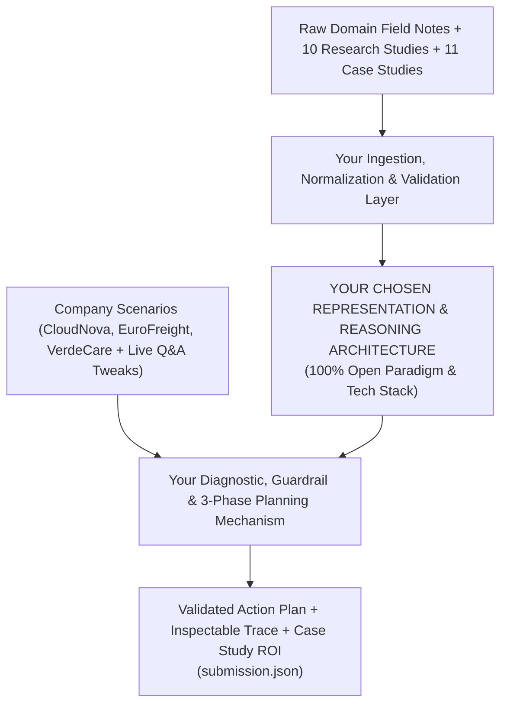

# Ingaze Hackathon Challenge Brief — Open Architecture & Structure Design

Welcome to the **Ingaze AI Architecture & Strategic Reasoning Challenge** at the Campus Founders Hackathon (20–22 Nov 2026)!

Unlike standard coding challenges where a rigid schema is handed to you to implement line-by-line, **this challenge puts your 3-person team in the seat of Chief AI Architect**. We tell you **what** business and diagnostic outcome Ingaze needs and give you **raw, schema-agnostic domain materials** (`data/ingaze_sandbox_dataset.json`).

**Your mission:** Invent, formalize, and prove the **most effective data representation, reasoning architecture, and technical tooling stack**—and demonstrate a working vertical slice in Python that solves our multi-pillar company scenarios without falling into causal, prerequisite, or industry traps.

> [!TIP]
> **New to Employer Branding & HR Metrics?** Read **[`HR_DOMAIN_PRIMER_FOR_ENGINEERS.md`](./HR_DOMAIN_PRIMER_FOR_ENGINEERS.md)** first (5 min)—it translates EVP, Say-Do Gap, CpH/TtH, EMV, Workforce Archetypes, and CFO thinking into plain engineering terms!  
> For the exact `submission.json` format and evaluation rubric, see **[`OUTPUT_CONTRACT_AND_RUBRIC.md`](./OUTPUT_CONTRACT_AND_RUBRIC.md)**.

---

## 1. Real Product Context: What Ingaze Does Today vs. What You Are Building

**Ingaze** (`ingaze.ai`) is a European B2B **Employer Intelligence** platform that helps enterprise HR Leaders and C-level Boards build data-driven Employer Strategy across **4 deeply interconnected HR Pillars**:

1. **Employer Branding & Reputation Intelligence:** Multi-channel public reputation (Glassdoor, Indeed, Google Reviews), cross-country/multi-site brand consistency, Employer Brand Alignment Index, and the **"Say-Do Gap"** (when external recruiting promises contradict internal employee reality).
2. **Recruiting & Talent Attraction:** Career Portal conversion & UX audit, Candidate Persona alignment, job description quality, technical engineering storytelling on LinkedIn, Time-to-Hire (TtH), and Cost-per-Hire (CpH).
3. **Employee Advocacy:** Data-driven employee brand ambassadors, organic social reach amplification, manual spreadsheet tracking vs. automated ambassador content tracking, and **Earned Media Value (EMV)** saved vs. paid ads.
4. **Retention & Internal Climate:** First-year new-hire attrition, workload burnout, middle management effectiveness, 360° internal listening, career progression clarity, and **Estimated Annual Attrition Exposure (€)**.

> [!IMPORTANT]
> **Why This Project Exists Inside Ingaze's Real Product:**
> - **Today:** Our platform **already identifies all the client warning signals and areas needing attention** across these 4 pillars (reputation gaps, career-site drop-offs, early churn, manual HR bottlenecks). However, **turning those detected signals into a prioritized strategic action plan is still done manually by our human experts**, relying on domain knowledge and past consulting cases kept in their heads.
> - **What we want to automate:** We want to build the **Action Recommendation Engine** that powers automated recommendations inside the platform.
> - **Why LLMs alone aren't enough:** LLMs don't fail here because they can't generate text—they fail because **they lack structured, living domain context**.
> - **What we need from your team:** Design a reusable **Context Collection & Organization Architecture** (capable of absorbing today's knowledge *plus* future studies and client cases as Ingaze grows—not static rules hard-coded for today's 6 notes!) and connect it to a **Recommendation Engine** that turns client diagnostic signals into safe, sequenced, ROI-backed actions.

### The Core Reasoning Objective
Given:
- **Layer A — Multi-Pillar Domain Field Notes & Empirical Research Benchmarks** (`10` research excerpts + `6` cross-pillar field notes),
- **Layer B — Anonymized B2B Consulting Case Studies** (`11` historical interventions with sector profile, intervention sequence, and measured Board ROI), and
- **Optional Ingestion Test Fixture (`sample_incoming_context_updates`)** — `2` short raw text updates (1 valid new field insight + 1 noisy/contradictory claim) provided strictly so you can test and demonstrate how your ingestion layer adds valid new context while flagging/rejecting bad rules (you are also welcome to test with your own custom updates during Sunday's demo!),

when a **Company Situation** arrives (representing the diagnostic warning signals our platform already detects for a client: industry, headcount, workforce target, organizational context, and detected issues), your system must:
1. **Diagnose Hidden Root Causes:** Trace surface symptoms across the 4 pillars back to their underlying structural causes (without hallucinating unrelated causes).
2. **Enforce Industry & Workforce Guardrails:** Block interventions that violate the company's sector or workforce reality (e.g., never recommend physical retail store weekend shift rotation to a cloud FinTech, or B2B LinkedIn technical-architecture blogging as the primary hiring channel for commercial truck drivers). Conversely, dynamically *activate* frontline/retail interventions when the company actually operates physical stores!
3. **Enforce 3-Phase Prerequisite Sequencing:** Order interventions into **`Phase 1` (Foundational Diagnostics & Calibrations) $\rightarrow$ `Phase 2` (Core Structural Fixes) $\rightarrow$ `Phase 3` (Cross-Pillar Scaling & Advocacy)**. For example, launching external Employee Advocacy *before* fixing an active Say-Do Gap or severe burnout will backfire and must be deferred to Phase 3.
4. **Ground Actions in Research & Case Study Precedents:** Retrieve the top matching Case Studies (with quantified Board ROI) and supporting empirical benchmarks.

---

## 2. Why Naive LLMs & Standard Vector RAG Fail Here

When you paste a company's HR problems into a flat LLM prompt or standard chunk-based vector RAG:
- **Sycophantic Prerequisite Blindness:** If the prompt says *"The CEO wants to launch a LinkedIn Employee Ambassador campaign next week"*, a flat LLM eagerly puts Advocacy in Week 1—even when 16% of new engineers are quitting due to broken recruiting promises and burnout!
- **Sector Contamination:** Semantic similarity over HR case studies frequently leaks retail/logistics frontline fixes into B2B SaaS plans (or vice versa) whenever words like *"turnover"* or *"hiring drop-off"* overlap.
- **Flat Laundry Lists vs. Causal Chains:** Standard RAG retrieves text chunks that *sound similar* without distinguishing surface symptoms from root causes or enforcing diagnostic prerequisites before redesigns.
- **Zero CFO Auditability:** Executive Boards will not approve a €250k HR roadmap from a black-box paragraph; they need an inspectable trace of *why* each action is sequenced and *which* precedent proves its ROI.

---

## 3. Full Architectural Freedom (Zero Preferred Paradigm!)

> [!IMPORTANT]
> **There is NO "secret preferred paradigm" for this challenge.**  
> We specifically want to see **different architectural approaches** compete head-to-head across the teams. Whether your team builds a relational decision matrix in SQLite/DuckDB, an agentic planner-verifier pipeline, a programmatic rule/policy engine in Python, a case-based hybrid retrieval ranker, or a graph/network representation—**we judge the clarity of your design, your engineering trade-offs, and how accurately your code solves the scenarios.** A clean, deterministic, well-engineered architecture always beats an over-engineered buzzword stack!



**Examples of radically different architectural families you can explore (or combine):**
1. **Structured Relational / Scoring & Decision Matrix:** (`SQLite`, `DuckDB`, `Pandas`, or normalized Pydantic tables + weighted feature matching + prerequisite & sector constraint checks).
2. **Agentic Decomposition & Verifier Pipeline:** (Specialized LLM extractor $\rightarrow$ domain planner $\rightarrow$ deterministic or agentic reviewer/verifier stage that audits prerequisites and sector fit before emitting the plan).
3. **Programmatic Policy / Rule & Constraint Engine:** (LLM parses unstructured text into canonical state predicates, then pure Python rules, state machines, Datalog, or SAT/SMT solvers compute root causes and Phase 1–2–3 ordering).
4. **Case-Based Reasoning (CBR) & Hybrid Retrieval Ranker:** (Structured metadata filtering + multi-attribute similarity scoring + precedent adaptation with prerequisite validation).
5. **Graph / Network / Semantic Representation:** (`NetworkX`, property graphs, or dependency networks modeling symptoms, interventions, prerequisites, and sector constraints).

---

## 4. Deliverables (Scoped for a 3-Person Weekend Sprint)

### Part 1 — `ARCHITECTURE.md` (Fill in `ARCHITECTURE_TEMPLATE.md`)
Consolidate your architectural design into one crisp, unambiguous engineering spec covering:
1. **Domain Representation & State Design:** Exact data models/tables/rules/objects, symptom-to-root-cause links, hard prerequisites, industry guardrails, and Case Study representation.
2. **Ingestion, Normalization & Reliability Controls:** How raw studies/cases enter your system without introducing contradictory rules or duplicating concepts (e.g., mapping *"6-month churn"* and *"first-year attrition"* to one consistent concept).
3. **Diagnostic, Constraint & Phase-Ordering Mechanism:** Exact step-by-step mechanics from raw scenario text $\rightarrow$ root causes $\rightarrow$ guardrail filtering $\rightarrow$ Phase 1/2/3 ordering $\rightarrow$ Top-3 Case Study scoring.
4. **Tech Stack & Production Trade-Offs:** Why your chosen architecture and tools outperform both a flat LLM prompt and alternative designs.

### Part 2 — Working Python PoC + `submission.json` + Live Demo
1. Build a working Python prototype that loads `data/ingaze_sandbox_dataset.json`, populates your representation, and diagnoses all **3 company scenarios** (`CloudNova Pay`, `EuroFreight Interport`, `VerdeCare Group`).
2. Compare your output against the **Naive Baseline** (`starter_baseline_and_validator.py --run-naive-baseline`).
3. Keep your logic **100% general & data-driven** (zero `if company == "CloudNova"` hardcoding—your system should handle live input tweaks or unseen company profiles cleanly during Q&A!).
4. Export your results in `submission.json` (committed to your GitHub repo) and verify zero format errors with:
   ```bash
   python starter_baseline_and_validator.py --validate submission.json
   ```
5. **Stretch Goals (Bonus):** (a) Live demo of your ingestion/validation layer ingesting 1 brand-new HR finding and rejecting a contradictory rule; or (b) lightweight CLI/HTML/Notebook trace inspection view showing *why* each root cause, guardrail, and phase was chosen.

---

## 5. How Your Team Will Be Judged

During Sunday Pre-Finals (`09:30–10:30`), we evaluate your work across both **Campus Founders' Official Hackathon Criteria** and **Ingaze's Technical Benchmark**:

| Official CF Jury Criterion | Weight | How Ingaze Evaluates It |
| :--- | :---: | :--- |
| **1. Problem Fit & Value** | **25%** | Accurate cross-pillar root-cause diagnosis, 100% immunity to industry traps, and CFO-credible Case Study ROI grounding. |
| **2. Technical Execution & PoC** | **30%** | Working live code on the test scenarios (with generalizable, non-hardcoded logic), valid 3-phase prerequisite sequencing, and clean comparison vs. naive baseline. |
| **3. Innovation & Approach** | **20%** | Originality, clarity, and rigor of your chosen representation, reasoning mechanics, and validation/reliability controls. |
| **4. Feasibility & Scalability** | **15%** | Honest engineering trade-offs (latency, token cost, determinism, maintainability) — could Ingaze ship and scale your design in production? |
| **5. Pitch & Demo Delivery** | **10%** | Clear narrative + **50% Live Demo Rule** (show real execution & inspectable reasoning traces, plus a 30-sec video/static fallback in case of Wi-Fi hiccups). |
