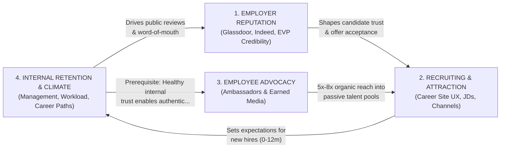

# HR, Employer Branding & CFO Mental Model — A 5-Minute Primer for AI Engineers

If you come from a pure AI, Data Science, or Software Engineering background, **HR and Employer Branding jargon can sound fuzzy at first**.  

This 5-minute guide strips away the buzzwords and gives you the **causal, operational, and financial mental model** behind enterprise Employer Intelligence—so your team can model the domain and invent high-leverage recommendations without guessing what terms mean.

---

## 1. The Core Mental Model: A Coupled 4-Pillar Feedback Loop + Dual Client Intake

Most outsiders think *Employer Branding* just means posting happy office photos on LinkedIn. In reality, enterprise talent operates as a **tightly coupled feedback loop across 4 pillars**:

### How Real Client Data Arrives at Ingaze (The Dual Flow)
When an enterprise client comes to Ingaze, our human strategists never look at a single flat paragraph in isolation. Every engagement combines **two complementary streams of information**:
1. **Ingaze Platform Signals (*Outside-In Analysis*):** What Ingaze's software detects externally and across digital touchpoints—Glassdoor/Indeed rating trends and location variance, Say-Do Gap between recruiting claims and review sentiment, Career Portal funnel conversion and mobile drop-off steps, job description quality, and LinkedIn organic engagement vs. manual HR tracking overhead.
2. **Client Internal Context (*Inside-Out Reality*):** What the client's HR and leadership team shares internally:
   - **Healthy baselines & strengths NOT to break:** Competitive compensation bands, high-retention core teams, modern physical assets, or already-authentic cultural pride.
   - **Cohort & site asymmetries:** Why Squad A or Hub North is thriving while Squad B or Hub South has 16% 6-month churn or a 43-day Time-to-Hire.
   - **Budget & operational constraints:** Lean HR teams losing 100–150+ hours/year on spreadsheets, or CFOs freezing ad spend until financial ROI is proven.
   - **Leadership perceptions & requests:** Executive ideas that may be spot-on—or may be premature/counterproductive (e.g., a CEO asking for an external Ambassador campaign next week while new hires are quitting, or a vendor pitching a 6-month EVP rewrite when the culture is already strong).

---

## 2. Plain-English Glossary of the 10 Key Domain Terms

| Term | Engineering Translation (Plain English) | Strategic Implication |
| :--- | :--- | :--- |
| **EVP (*Employer Value Proposition*)** | The **"SLA" a company promises talent**: what you get in exchange for working there (e.g., *engineering autonomy, career growth, reliable pay, modern fleet, B-Corp impact*). | Must match internal reality. If the EVP is already authentic, **do not waste months overhauling it**; if it contradicts reality, it creates a *Say-Do Gap*. |
| **The "Say-Do Gap"** | **Spec-vs-Production Drift.** Recruiting promises *"cutting-edge autonomy"*, but new hires hit micromanagement and opaque promotions on Day 30. | Drives **2.4x higher first-year turnover**, tanks review ratings (`>1.1★` gap), and causes external Employee Advocacy to backfire if not resolved first. |
| **Candidate Persona** | A data-backed specification of **what a specific workforce cohort optimizes for** and **which channels/devices they actually use**. | Prevents generic corporate job ads and stops you from using desk-based white-collar channels for mobile/deskless workers. |
| **Career Portal UX Audit** | Diagnostic UX, funnel, and device-conversion audit of a company's career website before rebuilding it. | Pinpoints the exact drop-off step (e.g., a 5-screen desktop account wall on mobile) before engineering a new application flow. |
| **TtH (*Time-to-Hire*) & CpH (*Cost-per-Hire*)** | **Latency** (days to fill an open role) and **unit acquisition cost** (€ spent per hire, especially emergency staffing/headhunting agency fees). | High application drop-off inflates TtH (`40+ days`) and forces Operations to burn budget on external temporary staffing agencies. |
| **Early Attrition (`0–12m` Turnover)** | New hires quitting within their first 6–12 months—the **most expensive failure mode in HR** (sunk recruiting + onboarding cost with zero output). | Almost always a downstream *symptom* of deeper root causes (expectation drift, uncoached middle managers, opaque career paths, or shift fatigue). |
| **360° Internal Listening** | Structured internal pulse & upward manager feedback to measure climate, workload, and leadership quality across specific teams/sites. | Essential diagnostic when internal turnover or management friction is present, so coaching targets the actual bottlenecked teams. |
| **Employee Advocacy & Ambassadors** | Real employees voluntarily sharing authentic professional content on social networks (`5x–8x` higher organic engagement than corporate brand pages). | **High-leverage amplifier, NOT a bandage.** Scales fast when internal trust is already healthy; backfires (*performative backlash*) during active burnout or a Say-Do Gap. |
| **Automated Ambassador Content Tracking** | Software tracking of ambassador reach and engagement—replacing HR manually chasing post screenshots in spreadsheets (`8–20h/month` wasted). | Eliminates manual spreadsheet drudgery and produces auditable Earned Media Value (`EMV €`) once an ambassador cohort is active/aligned. |
| **EMV (*Earned Media Value*) & Financial Turnover Risk (€)** | Translating HR outcomes into **CFO currency (€)**: paid-media equivalent saved via organic reach (`EMV €`) and annual attrition exposure (`Turnover Risk €`). | `78%` of HR budgets get rejected when pitched with vanity metrics (*likes, impressions*) instead of auditable `€` and operational hours saved. |

---

## 3. Diagnostic Sequencing, Readiness & Strategic Restraint

In real enterprise strategy, **order of operations and selective focus matter as much as the actions themselves**:

1. **Diagnose Before You Redesign:**  
   You wouldn't refactor a production codebase before profiling where the latency bottleneck lives. Similarly, foundational diagnostics (auditing multi-site reviews, profiling career portal mobile drop-off, listening to internal teams, or calibrating cohort personas) establish the evidence base needed to design targeted structural fixes.
2. **Cultural Readiness Governs Amplification:**  
   External amplification (like scaling an Employee Ambassador program or rewriting job ads around new cultural claims) depends on internal reality:
   - If a company suffers from an active **Say-Do Gap** or **management burnout**, external advocacy must wait until internal trust and leadership foundations are stabilized.
   - Conversely, if a company **already enjoys strong internal satisfaction, an authentic EVP, and enthusiastic organic ambassadors**, you do **not** need a redundant corporate EVP overhaul—you can focus directly on multi-site visibility, formalizing regional ambassadors, and automating tracking!
3. **Preserve What Works (*What NOT to Touch*):**  
   Clients respect an advisor who says: *"Your compensation is at the 82nd percentile and your Amsterdam SRE team has 94% retention—do NOT touch base pay or disrupt that hub; focus your budget on coaching newly promoted squad leads in Milan and Berlin."*

---

## 4. Workforce & Operational Context Sensitivity

One of the classic failure modes of naive LLMs and flat RAG is **context blindness**—treating every workforce segment as interchangeable. When designing your reasoning structure, pay attention to four operational dimensions:

- **Device & Application Behavior (Deskless Mobile vs. Desk-Based Specialist):**  
  Frontline, field, and shift-based workers (logistics drivers, warehouse staff, store associates) browse job openings on smartphones during short breaks and abandon desktop login walls within seconds. Senior software/cloud engineers rarely cold-apply on generic portals without seeing authentic technical architecture substance from peers.
- **Physical Schedule Reality vs. Digital Workplaces:**  
  Operational scheduling interventions (such as predictable weekend shift rotation in physical retail stores) directly solve frontline store burnout, but are completely meaningless if leaked into a 100% digital B2B SaaS or FinTech company via noisy data imports.
- **Multi-Site / Multi-Hub Variance vs. Single-Site Uniformity:**  
  In distributed organizations (5 logistics interports, 3 European tech hubs, or 50 regional healthcare clinics), averages lie. A `3.8★` company average often hides a `4.3★` flagship hub and a `3.1★` struggling region.
- **Tenured Core vs. Early-Career / New-Hire Cohorts:**  
  A company can simultaneously have `91%+` retention among tenured staff and a severe drop-off among Gen-Z university recruits or newly onboarded hires—requiring targeted cohort interventions rather than company-wide disruption.

---

## 5. How the Board & CFO Judge a Strategic Action Plan

Inside an enterprise client, your system's output must serve two stakeholders simultaneously:
1. **The HR / Talent Acquisition Leader:** Time-poor, buried in manual operational work (exporting LinkedIn stats or local facility reviews into Excel by hand), and looking for concrete, cohort-specific actions they can execute.
2. **The CFO / Executive Board:** Allergic to vague HR buzzwords. They ask four blunt questions:
   - *"What is this problem costing us in **EUR per year** (`Financial Turnover Risk`, `External Agency Spend`, `Manual HR Hours`)?"*
   - *"What are we deliberately **not** spending money on because it's already healthy or wrong for our workforce?"*
   - *"Why is Phase 1 before Phase 2, and what open questions should we verify in our internal data?"*
   - *"Which **comparable B2B precedent** in our sector proves the expected ROI?"*
